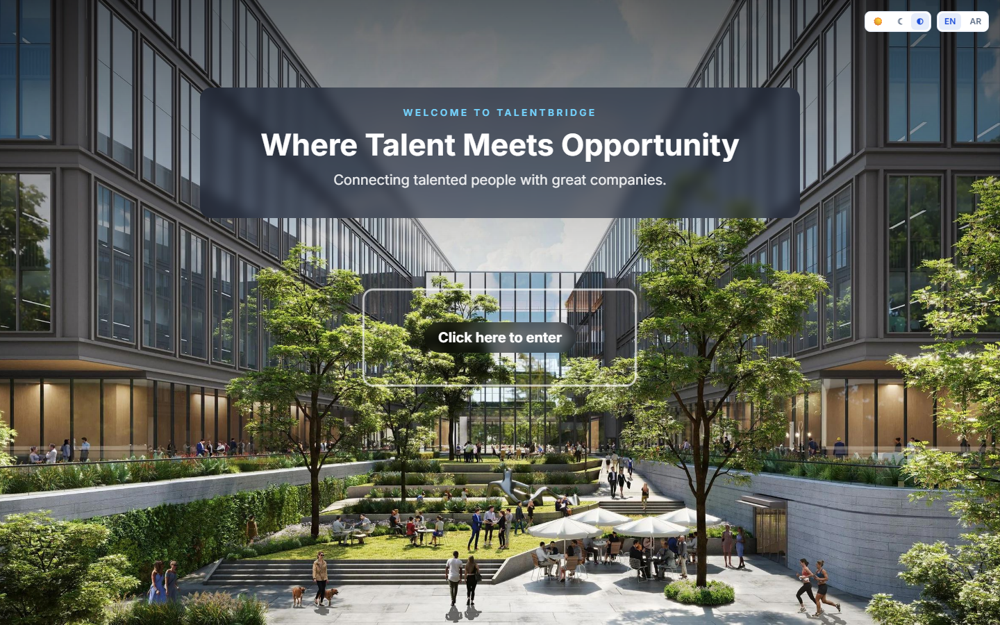
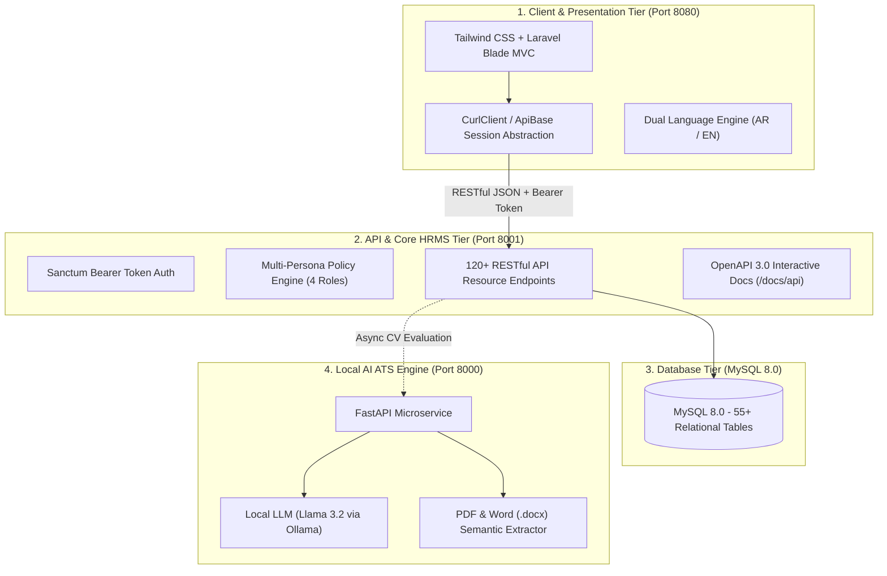
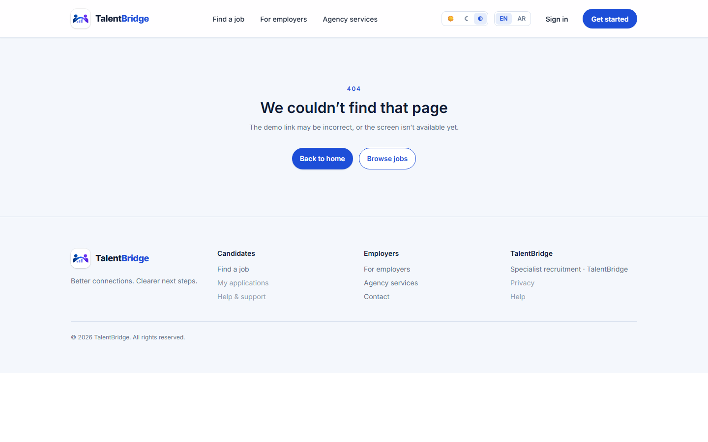
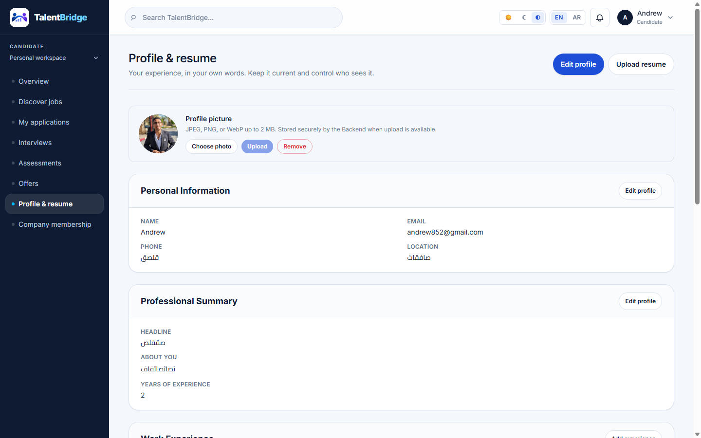
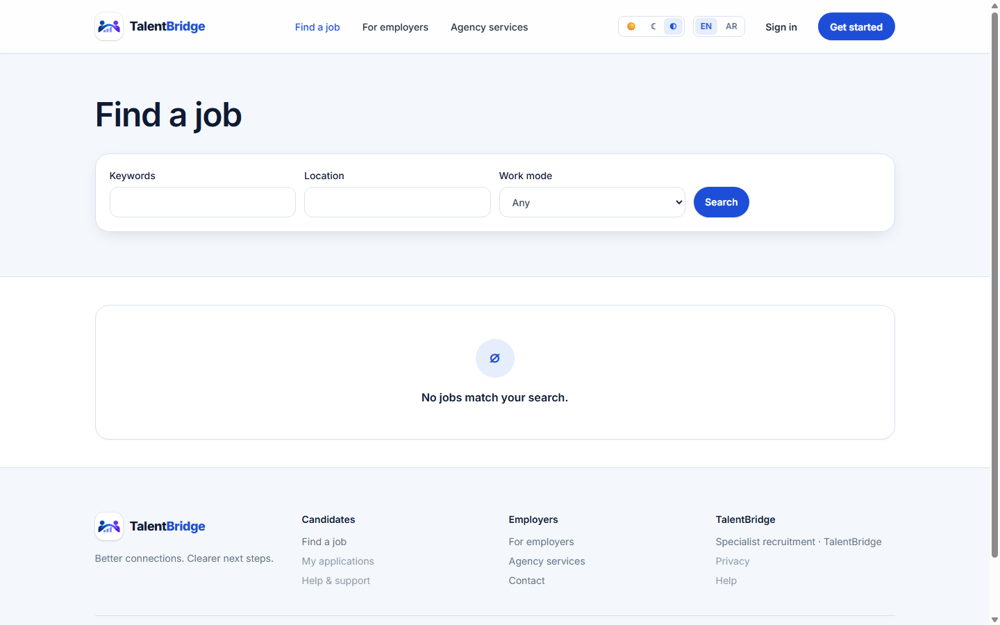
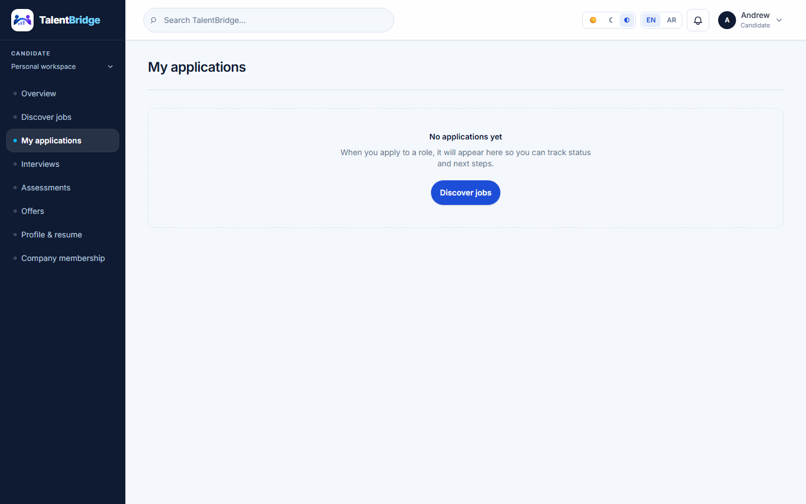
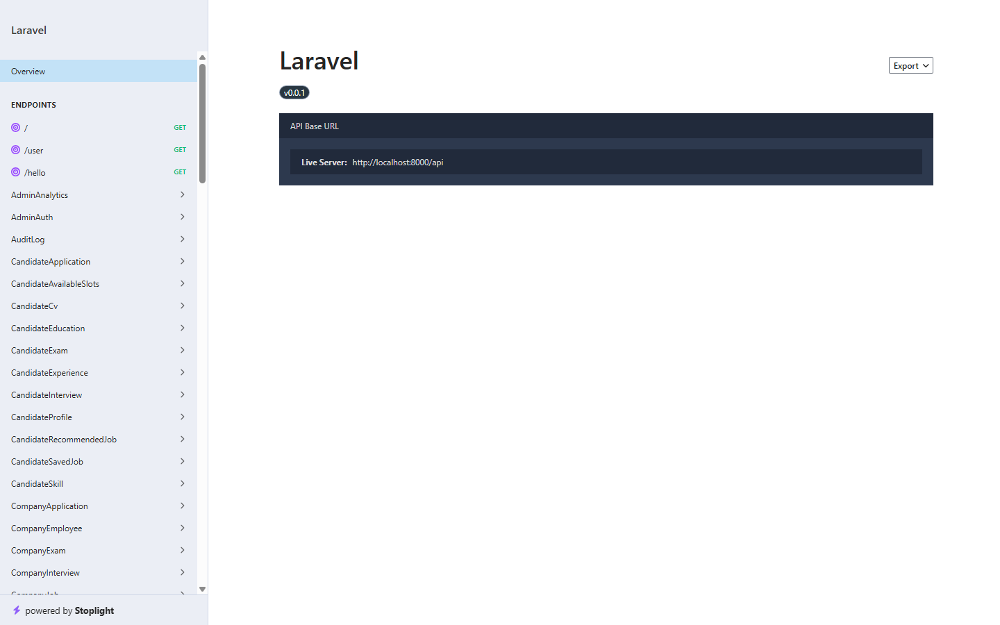
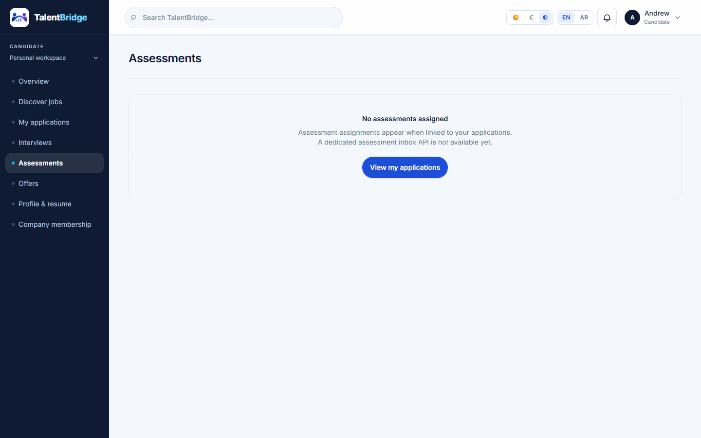

# TalentBridge: Next-Generation AI-Powered Recruitment & HR Platform

<p align="center">
  
</p>

<p align="center">
  <a href="https://laravel.com"></a>
  <a href="https://tailwindcss.com"></a>
  <a href="https://fastapi.tiangolo.com"></a>
  <a href="https://ollama.ai"></a>
  <a href="https://mysql.com"></a>
  <a href="https://scramble.dedoc.co"></a>
</p>

---

## 🌟 Executive Overview
**TalentBridge** is an enterprise-grade, multi-tenant digital recruitment ecosystem and Human Resource Management System (HRMS). It connects job-seeking candidates, hiring companies, technical interviewers, and platform administrators through an automated, data-driven hiring pipeline powered by **local, privacy-first AI resume parsing & semantic matching (Ollama Llama 3.2)**.

### 🎯 Key Architectural Pillars
- **Decoupled Architecture:** Separated modern presentation tier (Laravel Blade + Tailwind CSS), core business REST API (Laravel 12 + Sanctum), and intelligent AI ATS engine (Python / FastAPI).
- **Zero Cloud Leakage AI:** Local LLM semantic parsing evaluating resumes against job descriptions without sending candidate data to external servers.
- **Interactive Virtual Career Fair:** 3D/virtual exhibition hall connecting candidates with hiring company booths (`/hall/*`).
- **Complete End-to-End Governance:** Multi-role RBAC, automated pre-screening assessment tests, zero-ping-pong interview booking, and digital job offers.

---

## 🏛️ System Architecture



---

## 📂 Repository Directory Layout (Monorepo)

```
TalentBridge/
├── backend/                  # Core HRMS REST API (Laravel 12, Sanctum, 55+ MySQL Migrations)
│   ├── app/Http/Controllers/ # 120+ RESTful Resource Controllers
│   ├── routes/api.php        # Modular API routes (Candidate, Company, Admin, Interviewer)
│   └── database/migrations/  # Full relational database schema & seeders
│
├── frontend/                 # Decoupled Web Platform (Tailwind CSS, Blade, Multi-Language)
│   ├── app/Frontend/         # Client controllers & pure API consuming adapters
│   ├── resources/views/      # Responsive UI & Virtual Career Fair Exhibition Halls
│   └── lang/                 # English (LTR) & Arabic (RTL) localization dictionaries
│
├── ai_ats_service/           # Offline AI ATS Recruitment Engine (FastAPI + Ollama)
│   ├── ats_engine.py         # Semantic scoring, skill matching & gap analysis
│   ├── resume_parser.py      # PDF / DOCX deep text extraction
│   └── main.py               # REST API endpoints for resume evaluation
│
├── docs/                     # Specifications, Presentation Deck & System Artifacts
│   ├── screenshots/          # High-resolution UI captures of all portals
│   ├── TalentBridge_PROJECT_DOCUMENTATION.pdf
│   └── TalentBridge_Executive_Presentation.pptx
│
├── start-all.bat             # 1-Click launcher starting Database, Backend, Frontend & AI
└── README.md                 # System Master Documentation
```

---

## 👥 Multi-Role Stakeholder Portals

| Persona | Key Capabilities | Primary Route |
| :--- | :--- | :--- |
| **🎓 Candidate** | Profile passport, multi-version CV repository, social media links (LinkedIn/GitHub/Portfolio), job discovery, application tracking, online exams, interview booking. | `/candidate/dashboard` |
| **🏢 Employer (Company)** | Vacancy authoring & publishing, candidate pipeline management, applicant ATS match review, custom assessment exams creation, formal job offer issuance. | `/company/dashboard` |
| **🎙️ Technical Interviewer** | Self-service availability slot management, zero calendar ping-pong, structured evaluation scoring rubrics and feedback recording. | `/interviewer/interviews` |
| **🛡️ Super Admin** | Platform-wide KPIs & metrics, hiring company verification and approval workflows, user lifecycle governance, role permissions, and audit logs. | `/admin/dashboard` |

---

## 📸 Platform Previews & Screenshots

| Multi-Role Login Portal | Candidate Profile & Social Hub |
| :---: | :---: |
|  |  |

| Jobs Marketplace & Search | Application Pipeline Tracker |
| :---: | :---: |
|  |  |

| Backend Interactive OpenAPI Documentation | Online Pre-Screening Exams |
| :---: | :---: |
|  |  |

---

## ⚡ Quick Start & Installation

### 1. Prerequisites
- **PHP 8.2+ or 8.5+** & **Composer**
- **MySQL 8.0+** (or XAMPP)
- **Python 3.10+**
- **Ollama** running locally: `ollama run llama3.2`

### 2. Automated 1-Click Launch (Windows)
Simply run the bundled launcher at the repository root:
```cmd
start-all.bat
```
This automatically verifies MySQL, boots the Backend on `8001`, the Frontend on `8080`, the AI Engine on `8000`, and opens the browser!

---

### 3. Manual Step-by-Step Setup

#### A. Backend API Setup
```bash
cd backend
composer install
cp .env.example .env
php artisan key:generate

# Configure your MySQL credentials in .env, then:
php artisan migrate:fresh --seed

# Start the API server
php artisan serve --port=8001
```
* API Root: [http://127.0.0.1:8001/api](http://127.0.0.1:8001/api)
* Interactive OpenAPI Documentation: [http://127.0.0.1:8001/docs/api](http://127.0.0.1:8001/docs/api)

#### B. Frontend Web Platform Setup
```bash
cd ../frontend
composer install
cp .env.example .env
php artisan key:generate

# Verify backend URL in .env: API_URL=http://127.0.0.1:8001/api
php artisan serve --port=8080
```
* Web Portal: [http://127.0.0.1:8080](http://127.0.0.1:8080)

#### C. AI ATS Service Setup
```bash
cd ../ai_ats_service
pip install -r requirements.txt
python -m uvicorn main:app --host 127.0.0.1 --port 8000 --reload
```
* AI Engine Swagger: [http://127.0.0.1:8000/docs](http://127.0.0.1:8000/docs)

---

## 🔑 Pre-Configured Test Accounts

| Role | Email | Password |
| :--- | :--- | :--- |
| **Super Admin** | `admin@example.com` | `ChangeMe123!` |
| **Company Recruiter** | `company@example.com` | `Password123!` |
| **Job Candidate** | `candidate@example.com` | `Password123!` |
| **Technical Interviewer** | `interviewer@example.com` | `Password123!` |

---

## 📄 Documentation & Presentation Slides
- 📑 **[Complete Architecture Specification (PDF)](docs/TalentBridge_Full_Project_Documentation.pdf)**
- 📊 **[Executive Presentation Deck (PowerPoint)](docs/TalentBridge_Executive_Presentation.pptx)**
- 📝 **[Technical Markdown Specification](docs/PROJECT_DOCUMENTATION.md)**

---

## 👨‍💻 Author & Contact
**Andrew Ehab**  
* GitHub: [@AndrewEhab-Tech](https://github.com/AndrewEhab-Tech)
<!-- updated -->