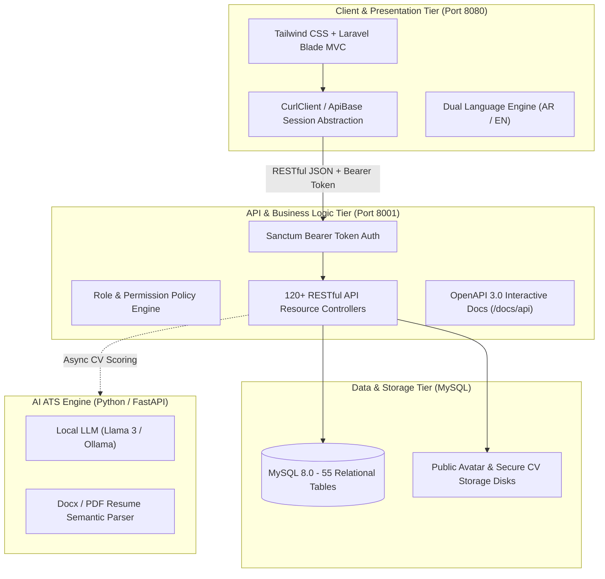
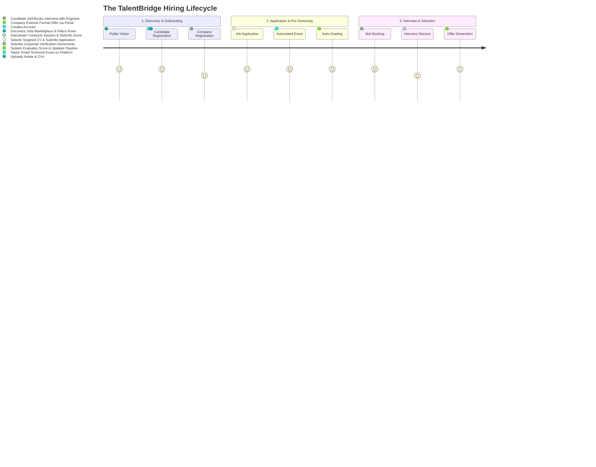

# TalentBridge: Complete End-to-End System & Architecture Documentation
> **Comprehensive Master Specification & Technical Reference Manual**  
> Covers: Architecture, Database Catalog, API Inventory, Multi-Role Portals, AI Engine, Installation & Deployment.

---

## 1. Executive Summary & System Overview

**TalentBridge** is an enterprise-grade, multi-tenant digital recruitment ecosystem and Human Resource Management System (HRMS). It connects job-seeking candidates, hiring companies, technical interviewers, and platform administrators through an automated, data-driven hiring pipeline.

### Core Value Propositions
- **Elimination of the "Resume Black Hole":** Transparent, real-time application milestone tracking for candidates from submission to final offer.
- **Objective Pre-Screening:** Automated technical exam engine evaluating applicant competence before senior engineers spend costly interviewing hours.
- **Dynamic Skills & Profile Passport:** Auto-suggesting skills taxonomy, multi-version resume repository, and verified employment ledger.
- **Frictionless Multi-Persona Access:** Role-segregated gateways for Candidates, Employers, Interviewers, and Super Admins.
- **AI-Powered ATS Matching:** Machine-learning semantic parsing between resumes and job requirements via local LLM infrastructure.

---

## 2. High-Level System Architecture

TalentBridge is engineered as a decoupled, multi-tier system:



### Component Breakdown
1. **Frontend Consumer (`Recuituitment_Platform_sondos-master`):**
   - **Framework:** Laravel 11.x, PHP 8.2+ / 8.5
   - **Styling:** Tailwind CSS, responsive utility components (`<x-card>`, `<x-button>`, `<x-modal>`).
   - **Integration Layer:** `CurlClient` communicates over HTTP with the backend API, automatically propagating bearer tokens stored in the encrypted session (`ApiSession`).
   - **Localization:** Dynamic English/Arabic language switching (`lang/en`, `lang/ar`).

2. **Backend REST API (`hr_managment_system`):**
   - **Framework:** Laravel 12.x / 11.x, PHP 8.2+ / 8.5
   - **Security:** Laravel Sanctum bearer token authentication, strict policy gates, rate limiting (`throttle:60,1`), and CSRF token protection.
   - **Documentation:** Interactive OpenAPI 3.0 specification generated via `dedoc/scramble` at `/docs/api` (Swagger UI).
   - **Database:** MySQL relational schema with 55 tables, ACID transaction safety, foreign keys, and audit logging.

3. **AI ATS Service (`ai_ats_service`):**
   - **Framework:** Python 3.10+, FastAPI / Uvicorn.
   - **Capabilities:** Semantic matching between candidate resumes and job criteria, text extraction from DOCX/PDF, skill gap analysis, and automated qualification scoring.

---

## 3. Complete Database Catalog (All 55 Tables)

Every table includes full schema integrity, foreign keys, and audit trail columns (`UID`, `LUID`, `created_at`, `updated_at`, `deleted_at`).

| # | Table Name | Primary Purpose / Role | Audit Trail Support |
|---|------------|------------------------|---------------------|
| 1 | `audit_logs` | Administrative and security audit events | Timestamps |
| 2 | `account_statuses` | Status lookup (1=Active, 2=Deactivated, 3=Blocked, 4=Deleted) | Full (UID, LUID, SoftDeletes) |
| 3 | `users` | Core user identities (Candidates, HR, Interviewers, Employees) | Full (UID, LUID, SoftDeletes) |
| 4 | `password_reset_tokens` | Framework password reset tokens | Framework Internal |
| 5 | `sessions` | HTTP session storage for web sessions | Framework Internal |
| 6 | `queue_jobs` | Background queue jobs | Framework Internal |
| 7 | `job_batches` | Batch execution tracking for background queues | Framework Internal |
| 8 | `failed_jobs` | Failed background queue records | Framework Internal |
| 9 | `roles` | User RBAC roles (`candidate`, `company_admin`, `hr`, `interviewer`, `employee`) | Full (UID, LUID, SoftDeletes) |
| 10 | `permissions` | Granular permission keys (`jobs.create`, `cvs.view`, `interviews.grade`) | Full (UID, LUID, SoftDeletes) |
| 11 | `role_permissions` | Pivot table mapping roles to permissions | Pivot (UID, LUID, Timestamps) |
| 12 | `companies` | Company profiles, verification documents, and account status | Full (UID, LUID, SoftDeletes) |
| 13 | `user_roles` | Pivot table mapping users to roles within companies | Pivot (UID, LUID, Timestamps) |
| 14 | `admins` | Isolated platform super administrator credentials | Full (UID, LUID, SoftDeletes) |
| 15 | `admin_roles` | Admin role taxonomy | Full (UID, LUID, SoftDeletes) |
| 16 | `admin_permissions` | Platform admin granular privileges | Full (UID, LUID, SoftDeletes) |
| 17 | `admin_role_permissions` | Pivot mapping admin roles to admin permissions | Pivot |
| 18 | `admin_role_assignments` | Pivot mapping admins to admin roles | Pivot |
| 19 | `company_social_links` | Social URLs (LinkedIn, Twitter, Website) for companies | Full (UID, LUID, SoftDeletes) |
| 20 | `company_employees` | Company employee rosters, titles, and approval statuses | Full (UID, LUID, SoftDeletes) |
| 21 | `candidate_profiles` | Candidate bio, headline, avatar photo, years of experience | Full (UID, LUID, SoftDeletes) |
| 22 | `candidate_experience` | Work history (company, title, start/end dates, description) | Full (UID, LUID, SoftDeletes) |
| 23 | `skills` | Master skill taxonomy (PHP, Laravel, Docker, React, etc.) | Full (UID, LUID, SoftDeletes) |
| 24 | `candidate_skills` | Pivot mapping candidate profiles to specific skills & proficiency levels | Pivot (UID, LUID, Timestamps) |
| 25 | `candidate_cvs` | Uploaded resume files (PDF/DOCX), versioning, primary flag | Full (UID, LUID, SoftDeletes) |
| 26 | `candidate_education` | Degree, educational institution, field of study, graduation year | Full (UID, LUID, SoftDeletes) |
| 27 | `candidate_courses` | Certifications, courses, and issuing educational organizations | Full (UID, LUID, SoftDeletes) |
| 28 | `candidate_social_links` | GitHub, Portfolio, and LinkedIn URLs for candidate | Full (UID, LUID, SoftDeletes) |
| 29 | `job_categories` | Job taxonomy categories (Engineering, Marketing, Design, Sales) | Full (UID, LUID, SoftDeletes) |
| 30 | `jobs` | Vacancy postings, descriptions, requirements, salary bands, status | Full (UID, LUID, SoftDeletes) |
| 31 | `job_skills` | Pivot mapping required technical skills to job postings | Pivot (UID, LUID, Timestamps) |
| 32 | `job_nominations` | Internal employee nominations for private job openings | Full (UID, LUID, SoftDeletes) |
| 33 | `job_interview_rounds` | Interview round definitions per job (Technical, HR, Cultural Fit) | Full (UID, LUID, SoftDeletes) |
| 34 | `applications` | Candidate job applications, targeted CV link, cover note | Full (UID, LUID, SoftDeletes) |
| 35 | `application_status_history` | Stage transition audit trail (Applied -> In Review -> Exam -> Interview -> Offer) | Full (UID, LUID, SoftDeletes) |
| 36 | `offers` | Formal job offers, base compensation, terms, acceptance state | Full (UID, LUID, SoftDeletes) |
| 37 | `interviews` | Interview sessions, type (online/onsite), meeting link, notes | Full (UID, LUID, SoftDeletes) |
| 38 | `interviewer_availability` | Open calendar time windows set by interviewers for booking | Full (UID, LUID, SoftDeletes) |
| 39 | `interview_bookings` | Confirmed appointments linking interview, time slot & interviewer | Full (UID, LUID, SoftDeletes) |
| 40 | `interview_evaluations` | Numerical score (0-100), internal notes, candidate feedback | Full (UID, LUID, SoftDeletes) |
| 41 | `calendar_integrations` | Google / Outlook OAuth calendar synchronization credentials | Full (UID, LUID, SoftDeletes) |
| 42 | `exams` | Technical assessments, duration limits, passing score threshold | Full (UID, LUID, SoftDeletes) |
| 43 | `job_exams` | Mapping between vacancies and required pre-screening exams | Full (UID, LUID, SoftDeletes) |
| 44 | `questions` | Question repository (MCQ, code challenge, open-ended text) | Full (UID, LUID, SoftDeletes) |
| 45 | `question_options` | Multiple-choice options and `is_correct` binary flags | Full (UID, LUID, SoftDeletes) |
| 46 | `question_test_cases` | Input/output test cases for automated coding challenges | Full (UID, LUID, SoftDeletes) |
| 47 | `exam_attempts` | Candidate exam sessions (tracks attempt numbers 1, 2, 3) | Full (UID, LUID, SoftDeletes) |
| 48 | `answers` | Candidate answers submitted for each exam question | Full (UID, LUID, SoftDeletes) |
| 49 | `grading_results` | Automated grading scores & breakdown per exam attempt | Full (UID, LUID, SoftDeletes) |
| 50 | `proctoring_events` | Anti-cheat logs (tab switches, webcam face detection events) | Full (UID, LUID, SoftDeletes) |
| 51 | `proctoring_reviews` | Final proctoring verdicts (Passed, Suspicious, Disqualified) | Full (UID, LUID, SoftDeletes) |
| 52 | `cv_match_results` | AI semantic match score (0-100) between resume and job description | Full (UID, LUID, SoftDeletes) |
| 53 | `ai_review_decisions` | AI recommendation logs & HR human override decisions | Full (UID, LUID, SoftDeletes) |
| 54 | `salary_records` | Anonymized market compensation benchmark data | Full (UID, LUID, SoftDeletes) |
| 55 | `personal_access_tokens` | Laravel Sanctum API authentication tokens | Framework Token Store |

---

## 4. Multi-Role Ecosystem & User Journeys



### 4.1. Candidate Experience
1. **Onboarding & Profile:** Register account -> Upload avatar image (persisted in public disk) -> Add bio and social profiles.
2. **Career Passport:** Add work experience (chronological ledger) -> Add skills with proficiency levels (`beginner`, `intermediate`, `advanced`, `expert`) -> Add education.
3. **Multi-Version Resume Management:** Upload multiple PDF/Word resumes (e.g. "Full-Stack CV", "Backend Lead CV") -> Designate default primary CV -> Direct download / deletion.
4. **Job Search & Application:** Search jobs by keyword, category, and salary -> 1-click apply with targeted resume and cover note.
5. **Real-Time Milestone Pipeline:** Track applications across stages: `Applied` -> `In Review` -> `Exam` -> `Interview` -> `Offer` / `Rejected`.
6. **Pre-Screening Exams:** Take timed assessments with instant result calculation.
7. **Interview Self-Booking:** Choose convenient slots based on interviewer availability.

### 4.2. Employer / Company Experience
1. **Corporate Profile:** Set up company identity, logo, social links, and business verification.
2. **Vacancy Management:** Draft, publish, edit, and close job postings with detailed requirements and salary ranges.
3. **Applicant Pipeline Dashboard:** Review candidates by vacancy, download submitted CVs, change applicant statuses.
4. **Exam Engine Management:** Create custom exams, assign questions (MCQ / Code), set passing grades, and link exams to specific vacancies.
5. **Team Governance:** Manage employee roster, approve or reject internal interviewers and recruiters.
6. **Job Offer Issuance:** Generate formal offers directly within the platform.

### 4.3. Technical Interviewer Experience
1. **Availability Publisher:** Publish recurring or one-off open time windows for interviews.
2. **Interview Dashboard:** View confirmed appointments, candidate resume, and vacancy details.
3. **Structured Evaluation:** Submit numerical scores (0-100) and written qualitative feedback after the interview.

### 4.4. Super Admin Console
1. **Company Moderation:** Verify business documentation, approve new companies, or suspend non-compliant accounts.
2. **User Administration:** Manage platform users, update statuses (`Active`, `Deactivated`, `Blocked`), and reset credentials.
3. **System Auditing:** Inspect audit trails, monitor API traffic, and review security logs.

---

## 5. RESTful API Inventory (Core Backend Endpoints)

All endpoints accept and return `application/json`. Authenticated routes require `Authorization: Bearer <sanctum_token>`.

### 5.1. Authentication & Account Management
| Method | Endpoint | Description | Auth Required |
|---|---|---|---|
| `POST` | `/api/auth/register` | Register new candidate or company user | No |
| `POST` | `/api/auth/login` | Authenticate credentials and generate Sanctum token | No |
| `GET` | `/api/auth/me` | Fetch authenticated user profile and roles | Yes (Bearer) |
| `POST` | `/api/auth/logout` | Invalidate current bearer token | Yes (Bearer) |
| `POST` | `/api/auth/change-password` | Update user password | Yes (Bearer) |
| `DELETE` | `/api/account` | Soft-delete user account and invalidate active sessions | Yes (Bearer) |
| `POST` | `/api/avatar` | Upload candidate avatar image (`jpeg,png,webp\|max:2048`) | Yes (Bearer) |

### 5.2. Public Job Discovery & Lookups
| Method | Endpoint | Description | Auth Required |
|---|---|---|---|
| `GET` | `/api/jobs` | Browse published jobs with search, category & salary filters | No |
| `GET` | `/api/jobs/{id}` | Retrieve single job vacancy details | No |
| `GET` | `/api/skills` | Auto-complete skill lookup with `?q=` search query | No |
| `GET` | `/api/countries` | List of countries for location dropdowns | No |
| `GET` | `/api/job-categories` | Master list of job industry categories | No |

### 5.3. Candidate Management
| Method | Endpoint | Description | Auth Required |
|---|---|---|---|
| `GET` | `/api/candidate/profile` | Retrieve candidate full profile, skills, education, CVs | Yes (Candidate) |
| `PUT` | `/api/candidate/profile` | Update candidate bio, headline, and personal details | Yes (Candidate) |
| `POST` | `/api/candidate/cvs` | Upload a new resume document (PDF/DOCX) | Yes (Candidate) |
| `DELETE` | `/api/candidate/cvs/{id}` | Delete a stored resume document | Yes (Candidate) |
| `POST` | `/api/candidate/skills` | Add a skill to candidate profile | Yes (Candidate) |
| `DELETE` | `/api/candidate/skills/{id}` | Remove a skill from candidate profile | Yes (Candidate) |
| `POST` | `/api/candidate/experiences` | Add employment history entry | Yes (Candidate) |
| `DELETE` | `/api/candidate/experiences/{id}` | Remove employment history entry | Yes (Candidate) |
| `POST` | `/api/candidate/educations` | Add education credential | Yes (Candidate) |
| `DELETE` | `/api/candidate/educations/{id}` | Remove education credential | Yes (Candidate) |

### 5.4. Applications & Pipeline
| Method | Endpoint | Description | Auth Required |
|---|---|---|---|
| `GET` | `/api/candidate/applications` | List all applications submitted by candidate with statuses | Yes (Candidate) |
| `POST` | `/api/jobs/{jobId}/apply` | Submit job application with targeted CV and cover note | Yes (Candidate) |
| `GET` | `/api/company/vacancies/{id}/applications` | Retrieve applicant pipeline for a job posting | Yes (Company) |
| `POST` | `/api/company/applications/{id}/status` | Advance or reject applicant stage | Yes (Company) |
| `POST` | `/api/company/offers` | Create and issue a formal job offer | Yes (Company) |

### 5.5. Exam Engine & Assessments
| Method | Endpoint | Description | Auth Required |
|---|---|---|---|
| `GET` | `/api/candidate/exams` | View assigned pre-screening exams | Yes (Candidate) |
| `GET` | `/api/candidate/exams/{id}/start` | Begin timed exam attempt and retrieve questions | Yes (Candidate) |
| `POST` | `/api/candidate/exams/{id}/submit` | Submit answers and trigger automated scoring | Yes (Candidate) |
| `POST` | `/api/company/exams` | Create a new technical assessment | Yes (Company) |
| `POST` | `/api/company/exams/{id}/questions` | Add question with options or test cases | Yes (Company) |

### 5.6. Interview Scheduling
| Method | Endpoint | Description | Auth Required |
|---|---|---|---|
| `GET` | `/api/interviews/available-slots` | Fetch open interview slots for a vacancy | Yes (Bearer) |
| `POST` | `/api/interviews/book` | Confirm interview appointment booking | Yes (Candidate) |
| `GET` | `/api/interviewer/interviews` | List scheduled interviews for interviewer | Yes (Interviewer) |
| `POST` | `/api/interviews/{id}/evaluations` | Submit score (0-100) and interview feedback | Yes (Interviewer) |

---

## 6. Seeded Default Credentials (Testing & Demo)

The platform comes pre-configured with active demonstration accounts for every role:

| Persona / Role | Email Address | Password | Intended Portal |
|---|---|---|---|
| **Super Admin** | `admin@hr.com` | `password` | `/admin/dashboard` |
| **Corporate Employer** | `company@hr.com` | `password` | `/company/vacancies` |
| **Candidate** | `candidate@hr.com` | `password` | `/candidate/profile` |
| **Technical Interviewer** | `interviewer@hr.com` | `password` | `/interviewer/interviews` |

---

## 7. Installation, Setup & Local Running Guide

### 7.1. Prerequisites
- **PHP:** 8.2 or 8.5 with `pdo_mysql`, `curl`, `mbstring`, `fileinfo`, `openssl` extensions.
- **Composer:** Dependency manager for PHP.
- **Node.js & npm:** For asset compilation (optional if using pre-built assets).
- **MySQL:** Version 8.0+ running on `127.0.0.1:3306`.
- **Python:** 3.10+ (for `ai_ats_service`).

### 7.2. Backend Setup (`hr_managment_system`)
```bash
cd "c:\Users\Andrew\Downloads\V5\hr_managment_system"

# 1. Install PHP dependencies
composer install

# 2. Configure environment file (.env)
cp .env.example .env
php artisan key:generate

# 3. Configure Database connection in .env:
# DB_CONNECTION=mysql
# DB_HOST=127.0.0.1
# DB_PORT=3306
# DB_DATABASE=hr_system
# DB_USERNAME=root
# DB_PASSWORD=

# 4. Run Migrations & Seed Default Data
php artisan migrate:fresh --seed

# 5. Create storage symlink for uploaded avatars & CVs
php artisan storage:link

# 6. Start the Backend API Server (Port 8001)
php artisan serve --port=8001
```
*Backend Swagger API Documentation is accessible at:* `http://127.0.0.1:8001/docs/api`

### 7.3. Frontend Client Setup (`Recuituitment_Platform_sondos-master`)
```bash
cd "c:\Users\Andrew\Downloads\V5\Recuituitment_Platform_sondos-master"

# 1. Install dependencies
composer install

# 2. Configure environment (.env)
cp .env.example .env
php artisan key:generate

# Ensure backend connection points to Port 8001:
# API_URL=http://127.0.0.1:8001/api

# 3. Clear caches
php artisan view:clear
php artisan config:clear

# 4. Start the Frontend Server (Port 8080)
php artisan serve --port=8080
# Or using PHP built-in server:
php -S 127.0.0.1:8080 -t public server.php
```
*Frontend Web Portal is accessible at:* `http://127.0.0.1:8080`

### 7.4. AI ATS Engine Setup (`ai_ats_service`)
```bash
cd "c:\Users\Andrew\Downloads\V5\ai_ats_service"

# 1. Install Python requirements
pip install -r requirements.txt

# 2. Launch ATS Server
run_ats_server.bat
# Or:
python main.py
```

---

## 8. Summary of Recent Improvements & Fixes
1. **Candidate Skills Crash Resolved:** Fixed `Call to a member function pluck() on array` error in `skills.blade.php` by wrapping raw lookup data safely in collections with defensive null handling.
2. **Avatar Upload & Refresh Persistence:** Implemented `POST /api/avatar` endpoint in `CandidateProfileController`, updated database photo path, and synchronized frontend session profile avatars.
3. **Account Deletion Flow:** Connected `DELETE /api/account` endpoint to soft-delete candidate records, revoke Sanctum tokens, clear frontend sessions, and redirect safely.
4. **Standalone 3D Presentation:** Created self-contained single-file 3D presentation (`TalentBridge_3D_Presentation.html`, 3.5 MB) with Base64 embedded screenshots and zero external dependencies.
5. **PowerPoint Executive Deck:** Generated 14-slide widescreen presentation (`TalentBridge_Spiderweb_Presentation.pptx` & `.ppsx`, 2.5 MB) with native OpenXML Morph 3D slide transitions.

